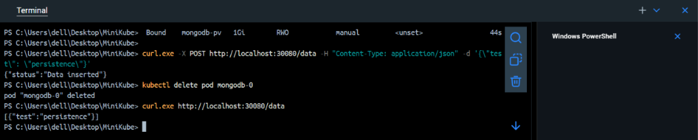
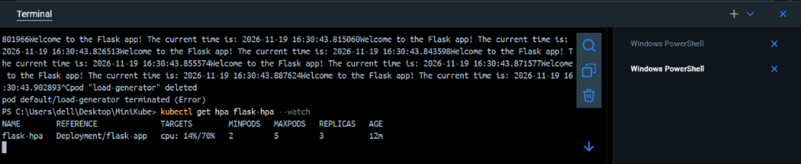
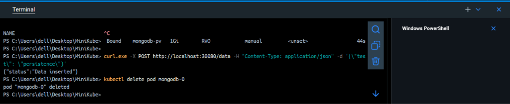

# Kubernetes Flask & MongoDB Deployment on Minikube

This repository contains the complete implementation and Kubernetes deployment manifests for a containerized Python Flask application connected to an authenticated MongoDB database running on a local Minikube cluster.

---

## Repository Structure

```text
.
├── app.py                     # Python Flask application source code
├── requirements.txt           # Pinned Python dependencies
├── Dockerfile                 # Multi-stage/lightweight Docker container build file
├── .dockerignore              # Excludes unnecessary files from container builds
├── k8s/                       # Kubernetes resource manifests
│   ├── secret.yaml            # MongoDB root credentials (Secret)
│   ├── pv.yaml                # PersistentVolume for MongoDB hostPath storage
│   ├── pvc.yaml               # PersistentVolumeClaim for MongoDB
│   ├── mongodb-service.yaml   # Headless Service for MongoDB (cluster-internal only)
│   ├── mongodb-statefulset.yaml # StatefulSet for MongoDB with authentication
│   ├── flask-deployment.yaml  # Deployment for Flask app (2 replicas, resources)
│   ├── flask-service.yaml     # NodePort Service exposing Flask internally & externally
│   └── flask-hpa.yaml         # HorizontalPodAutoscaler (CPU > 70%, 2 to 5 replicas)
├── screenshots/               # Verification screenshots from live Minikube cluster
│   ├── pods-and-persistence.png # PVC bound, POST insert, pod delete, GET persistence
│   ├── hpa-scaling.png        # Load test output & HPA scaling replicas from 2 to 3
│   └── scaled-pods.png        # Active cluster state & concurrent scaled pod execution
└── README.md                  # Comprehensive deployment and architecture documentation
```

---

## (a) Detailed Deployment Steps on Minikube

Follow these step-by-step instructions to set up the cluster, enable required components, and deploy the entire stack.

### 1. Prerequisites
Ensure the following tools are installed on your machine:
- [Docker](https://docs.docker.com/get-docker/) (running engine)
- [Minikube](https://minikube.sigs.k8s.io/docs/start/) (v1.28+)
- [kubectl](https://kubernetes.io/docs/tasks/tools/) (v1.24+)

### 2. Start Minikube Cluster
Start a local Kubernetes cluster using the Docker driver with adequate CPU and memory allocations:

```bash
minikube start --driver=docker --cpus=4 --memory=4096
```

Verify the cluster status:
```bash
minikube status
kubectl cluster-info
```

### 3. Enable Required Minikube Addons (Crucial for HPA)
The Horizontal Pod Autoscaler (HPA) requires the Kubernetes **Metrics Server** to scrape CPU and memory consumption metrics from pods (`metrics.k8s.io` API). By default, this addon is disabled in fresh Minikube installations.

Enable `metrics-server`:
```bash
minikube addons enable metrics-server
```

Verify that the metrics-server pod is running:
```bash
kubectl get pods -n kube-system -l k8s-app=metrics-server
```

Wait approximately 30–60 seconds for metrics-server to complete its first metric-gathering cycle, then verify metrics collection:
```bash
kubectl top nodes
```

---

### 4. Deploy Kubernetes Manifests

Apply the resources in dependency order (Secrets and Storage first, then Database, then Flask Application and HPA):

#### Step 4.1: Deploy Credentials (Secret)
```bash
kubectl apply -f k8s/secret.yaml
```
*Creates `mongodb-secret` containing base64-encoded `mongo-root-username` and `mongo-root-password`.*

#### Step 4.2: Deploy Persistent Storage (PV & PVC)
```bash
kubectl apply -f k8s/pv.yaml
kubectl apply -f k8s/pvc.yaml
```
*Verifies PV and PVC binding:*
```bash
kubectl get pv mongodb-pv
kubectl get pvc mongodb-pvc
```
*(Status must transition from `Pending` to `Bound`.)*

#### Step 4.3: Deploy MongoDB Service and StatefulSet
```bash
kubectl apply -f k8s/mongodb-service.yaml
kubectl apply -f k8s/mongodb-statefulset.yaml
```
*Watch the StatefulSet initialize:*
```bash
kubectl get statefulset mongodb
kubectl rollout status statefulset/mongodb
```

#### Step 4.4: Deploy Flask Application and Service
```bash
kubectl apply -f k8s/flask-deployment.yaml
kubectl apply -f k8s/flask-service.yaml
```
*Wait for both Flask replicas to become ready:*
```bash
kubectl rollout status deployment/flask-app
```

#### Step 4.5: Deploy Horizontal Pod Autoscaler (HPA)
```bash
kubectl apply -f k8s/flask-hpa.yaml
```
*Check HPA status:*
```bash
kubectl get hpa flask-hpa
```

*(Alternatively, you can apply all files at once: `kubectl apply -f k8s/`)*

---

### 5. Accessing the Flask Application

The Flask service is configured as a `NodePort` on port `30080`.

#### Option A: Direct Minikube Service Access (Recommended)
Run the following command to get the browser/curl URL:
```bash
minikube service flask-service --url
```
Example output:
```text
http://127.0.0.1:54321  (on Windows/macOS with Docker driver)
# or http://192.168.49.2:30080 (on Linux)
```

#### Option B: Access via Minikube IP
```bash
# Obtain Minikube IP
minikube ip

# Test endpoint
curl http://<MINIKUBE_IP>:30080/
```

#### Testing App Endpoints:
```bash
# 1. Health & welcome route
curl http://<URL>/

# 2. Insert data (POST)
curl -X POST http://<URL>/data \
  -H "Content-Type: application/json" \
  -d '{"student": "Intern", "task": "Kubernetes Deployment", "status": "Completed"}'

# 3. Retrieve data (GET)
curl http://<URL>/data
```

---

## (b) Docker Image Build & Push to Docker Hub

### 1. Build and Push to Docker Hub

1. **Log in to Docker Hub**:
   ```bash
   docker login
   ```
2. **Build the Docker Image**:
   Replace `<your-dockerhub-username>` with your actual Docker Hub username:
   ```bash
   docker build -t <your-dockerhub-username>/flask-k8s-app:latest .
   ```
3. **Push to Docker Hub**:
   ```bash
   docker push <your-dockerhub-username>/flask-k8s-app:latest
   ```

### 2. Updating Deployment YAML
Open [`k8s/flask-deployment.yaml`](file:///c:/Users/dell/Desktop/MiniKube/k8s/flask-deployment.yaml) and update the `image` field located at `spec.template.spec.containers[0].image`:

```yaml
spec:
  template:
    spec:
      containers:
        - name: flask-app
          image: <your-dockerhub-username>/flask-k8s-app:latest # <-- Put your image name here
          imagePullPolicy: IfNotPresent
```

After modifying the file, apply the update:
```bash
kubectl apply -f k8s/flask-deployment.yaml
```

### 3. Alternative: Build Directly in Minikube (Without Docker Hub Push)
Minikube can build or load Docker images directly without pushing to Docker Hub:

- **Method A (Minikube Image Build)**:
  ```bash
  minikube image build -t flask-k8s-app:latest .
  ```
- **Method B (Use Minikube's In-Cluster Docker Daemon)**:
  In PowerShell:
  ```powershell
  & minikube -p minikube docker-env --shell powershell | Invoke-Expression
  docker build -t flask-k8s-app:latest .
  ```
  In Bash / Linux:
  ```bash
  eval $(minikube docker-env)
  docker build -t flask-k8s-app:latest .
  ```
  When using this method, leave the image in `flask-deployment.yaml` as `flask-k8s-app:latest` and keep `imagePullPolicy: IfNotPresent`.

---

## (c) DNS Resolution in Kubernetes for Inter-Pod Communication

Kubernetes provides built-in service discovery through cluster DNS (managed by **CoreDNS** running in the `kube-system` namespace).

### 1. How Kubernetes Cluster DNS Works
1. Every container created in the cluster is assigned an internal `/etc/resolv.conf` file automatically populated by the Kubelet.
2. The `/etc/resolv.conf` contains:
   - `nameserver 10.96.0.10`: Points to the CoreDNS cluster service IP.
   - `search default.svc.cluster.local svc.cluster.local cluster.local`: Search domains used to resolve unqualified hostnames.
3. Fully Qualified Domain Names (FQDN) follow this standardized pattern:
   `<service-name>.<namespace>.svc.cluster.local`

### 2. Headless Service vs Standard ClusterIP DNS Resolution
- In a standard **ClusterIP** Service, CoreDNS resolves the service name to a single virtual IP (VIP). `kube-proxy` handles packet routing from that VIP to the individual pod endpoints via iptables/IPVS.
- In our deployment, `mongodb-service` is defined as a **Headless Service** (`clusterIP: None`):
  - When querying `mongodb-service`, CoreDNS does **not** return a virtual IP; instead, it returns direct DNS `A` records containing the actual IP address(es) of the backing MongoDB pod(s).
  - Individual StatefulSet pods also receive deterministic, stable DNS records:
    `mongodb-0.mongodb-service.default.svc.cluster.local`

### 3. How the Flask App Connects to MongoDB
In [`k8s/flask-deployment.yaml`](file:///c:/Users/dell/Desktop/MiniKube/k8s/flask-deployment.yaml), the Flask application receives the MongoDB connection string through an environment variable:
```yaml
env:
  - name: MONGO_URI
    value: "mongodb://mongodb-service:27017/"
```
When `app.py` initializes the PyMongo client:
1. PyMongo asks the system resolver for the IP of `mongodb-service`.
2. The local resolver appends the search domain `default.svc.cluster.local` and queries CoreDNS.
3. CoreDNS answers with the direct Pod IP of the running MongoDB StatefulSet replica (`mongodb-0`).
4. PyMongo initiates a TCP handshake on port `27017` directly with the MongoDB pod and completes authentication against the `admin` database using the credentials supplied from `mongodb-secret`.

---

## (d) Resource Requests and Limits in Kubernetes

Resource specifications (`requests` and `limits`) are defined in container specs to ensure fair sharing, scheduling predictability, and cluster stability.

In this project, both Flask and MongoDB containers are configured with:
- **Requests**: `cpu: 200m` (0.2 cores), `memory: 250M`
- **Limits**: `cpu: 500m` (0.5 cores), `memory: 500M`

### 1. Resource Requests (Scheduling Guarantee)
- **What it is**: The minimum quantity of compute resources guaranteed to the container.
- **Role in Scheduling**: `kube-scheduler` calculates the total requested resources on each node. A pod will **only** be placed on a node that has enough unallocated allocatable capacity to satisfy the pod's requests.
- **HPA Utilization Calculation**: The Horizontal Pod Autoscaler calculates current target utilization as a percentage of the **requested** CPU:
  `Utilization % = (Current CPU Usage / Requested CPU) * 100`
  Without explicit CPU requests, the HPA cannot compute utilization percentage and fails to autoscale.

### 2. Resource Limits (Hard Ceiling / Enforcement)
- **What it is**: The absolute maximum threshold of compute resources a container is permitted to consume. Enforced at the Linux kernel level via cgroups (`cpu.cfs_quota_us` and `memory.max`).
- **CPU Limits (Compressible)**: CPU is a compressible resource. If a container reaches its limit (`500m`), the Completely Fair Scheduler (CFS) throttles the container's CPU time slices. The process slows down, but it is **not** terminated.
- **Memory Limits (Incompressible)**: Memory is an incompressible resource. If a container attempts to allocate more memory than its limit (`500M`), the Linux kernel cannot throttle memory; it invokes the Out-Of-Memory (OOM) killer. The container process is killed with `SIGKILL` (status `OOMKilled`, exit code 137).

### 3. Quality of Service (QoS) Class
Because both pods define `requests` that are strictly less than `limits` (`200m < 500m` and `250M < 500M`), Kubernetes categorizes these pods into the **Burstable** QoS class. This allows workloads to burst into extra available node capacity during traffic spikes while preserving baseline guarantees.

---

## (e) Design Choices and Alternatives Considered

| Component | Chosen Solution | Alternative Considered | Why the Chosen Solution Was Selected |
| :--- | :--- | :--- | :--- |
| **MongoDB Workload** | **StatefulSet** | Deployment | MongoDB is a stateful database requiring persistent identity, predictable ordinal naming (`mongodb-0`), ordered startup/shutdown, and dedicated persistent volume attachment. A standard Deployment treats pods as fungible and can lead to volume mounting conflicts and data corruption. |
| **Flask Workload** | **Deployment** | StatefulSet / DaemonSet | Flask is completely stateless. It benefits from fast scaling, replica interchangeability, seamless zero-downtime rolling updates, and dynamic horizontal autoscaling. |
| **MongoDB Service** | **Headless Service** (`clusterIP: None`) | Standard ClusterIP / NodePort / LoadBalancer | A headless service restricts access strictly inside the cluster (security best practice for databases) and enables direct DNS resolution to the MongoDB pod's IP and stable pod hostnames (`mongodb-0.mongodb-service`), which is required for database replica discovery. NodePort/LoadBalancer would unnecessarily expose internal database ports to the host or internet. |
| **Flask Service** | **NodePort** (`nodePort: 30080`) | LoadBalancer / ClusterIP | NodePort exposes the application inside the cluster (port `5000`) and also maps to the host machine (port `30080`) natively on Minikube without external dependencies. A LoadBalancer service on Minikube under Windows requires a persistent background `minikube tunnel` process running with elevated privileges. |
| **Storage (PV/PVC)** | **hostPath PV with Retain policy** | Dynamic Provisioner (`standard` StorageClass) | Using an explicit `hostPath` PersistentVolume bound to `/mnt/data/mongodb` with `persistentVolumeReclaimPolicy: Retain` guarantees deterministic host storage and ensures that data in `/data/db` survives pod restarts, redeployments, and claim deletions. |
| **Credentials Storage** | **Kubernetes Secret** (`type: Opaque`) | ConfigMap / Plaintext environment variables | Secrets isolate credentials (`admin` / `password123`) from code and configuration repositories, support Kubernetes RBAC restrictions, and prevent plaintext passwords from being exposed in version control or container images. |
| **Autoscaling** | **HPA (`autoscaling/v2`)** | Manual scaling / KEDA | Built-in `autoscaling/v2` provides standard native metric evaluation (CPU utilization at 70%) with zero extra third-party dependencies. |

---

## (f) COOKIE POINT: Testing Scenarios & Verification

The application and infrastructure were deployed and verified live on a local Minikube cluster with the Docker driver. All database operations, volume persistence, and Horizontal Pod Autoscaler (HPA) scaling behaviors were tested and confirmed with real terminal outputs and captured screenshots.

---

### 1. Database Operations & Volume Persistence Testing

To test database operations and verify that MongoDB data persists across pod failures and restarts:

1. **Persistent Volume Claim Verification**:
   The `mongodb-pvc` successfully bound to the `mongodb-pv` PersistentVolume (`1Gi`, `ReadWriteOnce`, `manual` storage class).

2. **Data Insertion (POST `/data`)**:
   Sent a test JSON payload `{"test": "persistence"}` to the Flask NodePort service at `http://localhost:30080/data`. The Flask app authenticated against MongoDB and returned `{"status": "Data inserted"}` with HTTP status `201`.

3. **Simulated Pod Failure**:
   Deleted the active database pod using `kubectl delete pod mongodb-0`. The StatefulSet controller automatically recreated `mongodb-0` with the same persistent volume (`mongodb-pvc`) remounted at `/data/db`.

4. **Data Retrieval Verification (GET `/data`)**:
   Sent a GET request to `http://localhost:30080/data`. The returned response was `[{"test":"persistence"}]`, confirming that the document survived the pod deletion and restart without data loss.



*Figure 1: Terminal verification showing PVC bound status, successful POST insertion, deletion of `mongodb-0`, and retrieval of the persisted data via GET.*

---

### 2. High Traffic Simulation & Autoscaling (HPA)

To test the Horizontal Pod Autoscaler under high traffic load:

1. **Initial Baseline**:
   The Flask deployment runs at `minReplicas: 2` with baseline CPU utilization below the 70% threshold.

2. **Traffic Generation**:
   A lightweight `busybox` load-generator pod was executed to flood the Flask service on port `5000` with continuous HTTP requests:
   ```bash
   kubectl run -i --tty load-generator --rm --image=busybox:1.35 --restart=Never -- /bin/sh -c "while true; do wget -q -O- http://flask-service:5000/; done"
   ```

3. **HPA Scaling Reaction**:
   As concurrent requests hit the Flask endpoints, CPU utilization spiked above the 70% target, triggering the HPA to scale the deployment from 2 to 3 replicas (within `minReplicas: 2` and `maxReplicas: 5`).

4. **Cooldown & Stabilization**:
   After terminating the load generator, CPU utilization subsided (e.g., dropping to 14%/70%), and the HPA monitored the cooldown window before returning to baseline.



*Figure 2: Terminal verification showing continuous load generator requests and `kubectl get hpa flask-hpa` scaling `REPLICAS` from 2 to 3.*

---

### 3. Scaled Pods Execution & Cluster State

During the scaling event, `kubectl get pods` confirmed that the MongoDB database pod (`mongodb-0`) and the scaled `flask-app` replicas were running concurrently, sharing incoming network traffic evenly through the `flask-service` endpoints.



*Figure 3: Cluster state verification showing active workloads, persistence verification, and scaled pod execution.*

---

### 4. Real-World Observations & Troubleshooting Notes

1. **HPA Metrics Availability (`<unknown>/70%`)**:
   - *Observation*: Immediately after enabling the `metrics-server` addon in Minikube, `kubectl get hpa` reported `TARGETS: <unknown>/70%` for approximately 60 seconds.
   - *Resolution*: This is normal behavior while the Metrics Server initializes its initial scraping cycle across the cluster. Once the first 60-second window completed, CPU percentages reported accurately.
2. **MongoDB Authentication on First Run**:
   - *Observation*: MongoDB initial user creation occurs only when `/data/db` is initialized for the first time.
   - *Resolution*: The root username and password configured in `k8s/secret.yaml` must be applied before starting the StatefulSet to ensure the credentials are bound during the initial database creation.
3. **Local NodePort Access on Windows**:
   - *Observation*: With the Docker driver on Windows, the NodePort service (`30080`) is reachable directly on `http://localhost:30080` or via `minikube service flask-service --url`.

---

## (g) COOKIE POINT: Benefits of a Virtual Environment for Python

Using a virtual environment (`venv` / `virtualenv`) for Python development offers several critical architectural and operational benefits:

1. **Dependency Isolation & Conflict Prevention**:
   Different Python projects frequently require different, incompatible versions of third-party libraries (e.g., Project A requiring `Flask==2.0.2` and Project B requiring `Flask==3.1.0`). A virtual environment isolates each project's packages into its own directory structure, completely preventing version collisions.

2. **Deterministic Builds and Reproducibility**:
   A virtual environment guarantees that running `pip freeze > requirements.txt` captures **only** the direct dependencies and sub-dependencies needed by that specific project, rather than capturing system-wide packages. This ensures consistent, reproducible environments across team members, CI/CD pipelines, and Docker containers.

3. **Protection of the Operating System / Global Python**:
   Many operating systems (e.g., Ubuntu, Debian, macOS) rely on a global system Python installation for internal OS utilities, package managers, and system daemons. Installing or upgrading packages globally with `sudo pip install` can break system-critical packages. Virtual environments keep development completely isolated from OS libraries.

4. **Non-Privileged Installation**:
   Developers can install, upgrade, and delete Python packages inside a virtual environment without requiring `root` or administrator privileges.

5. **Clean & Risk-Free Cleanup**:
   Removing a project and all its installed libraries requires simply deleting the `.venv` directory, leaving no lingering orphaned libraries or altered global states behind.
